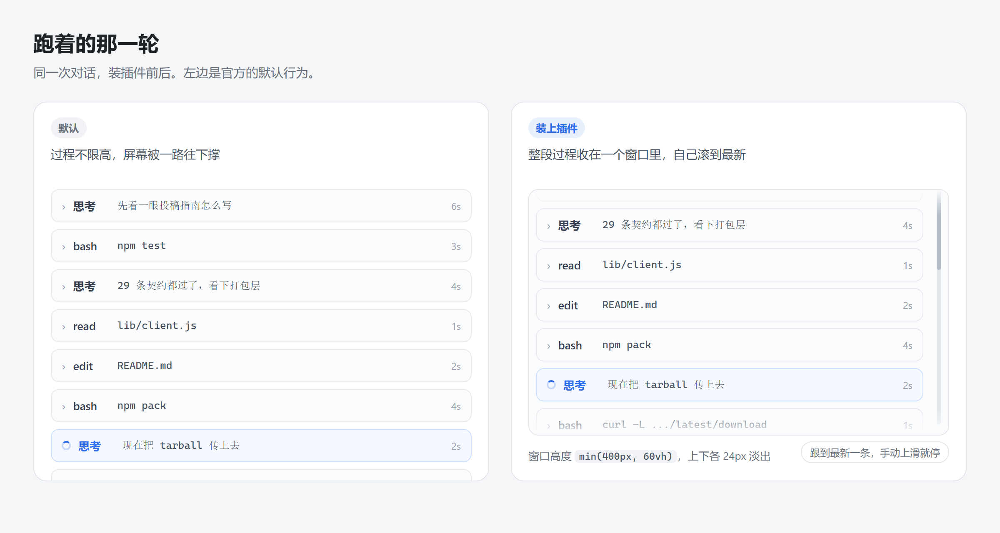
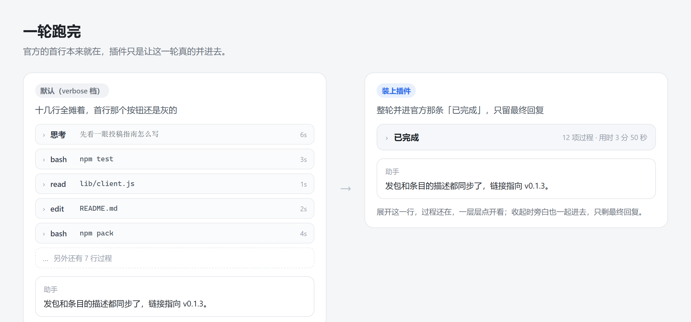
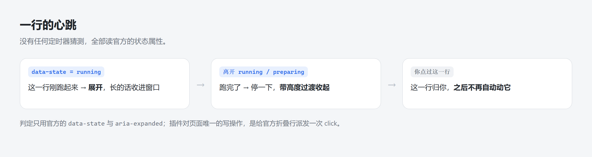

<div align="center">

# dsh-think-fold

正在跑的那一行自己展开，跑完自己收起；一轮结束，整轮并进官方那条「已完成」。



</div>

---

dsh-think-fold is a client-side plugin with a narrow job: it watches for the row that is running and clicks the app's own disclosure control a moment earlier than you would. It renders nothing itself, so rows, code blocks and diffs stay the app's own, and uninstalling puts back the two official settings it changed.

中文：插件只做一件事 —— 盯住「现在是哪一行在跑」，然后比你早一点点去点官方自己的开合控件。

模型思考的时候展开那条思考行，开始跑工具的时候展开那张工具卡，跑完再收回成一行摘要。一轮结束，整轮的思考和命令并进官方那条「已完成 · 用时」。你手动开合过的行会被记下来，之后不再动。

排版、字号、代码块、diff、图片全部来自官方：没有自绘面板，也没有自己的样式表或 Markdown 实现。对页面只有两处写操作 —— 给官方折叠行派发一次 `click`，以及照官方「已结束轮次」已经用过的办法给过程体加一个高度上限。哪个在跑，同样只读官方公布的状态，不看时钟，不做启发式。

## 它做什么

覆盖两类行：官方的「思考」行，和官方的工具卡（bash、edit / write、read、搜索、网页、子代理、工作流…）。

| 时刻 | 行为 |
|---|---|
| 模型开始思考 | 点开那条官方的「思考」行，正文按官方原样铺开 |
| 开始调工具 | 思考那条收起，正在执行的那张工具卡展开 |
| 工具执行完 | 那张工具卡收回官方的一行摘要 |
| 下一步开始 | 上一条按同一规则继续轮换 |
| 你手动开合过某条 | 记下来，永不自动动它 —— 包括你手动收起正在跑的那条，也不抢回来 |
| 跑着的时候 | 这一轮的所有过程待在一个限高窗口里，窗口自己滚到最新，页面不再被越堆越长的过程拽着走 |
| 一轮跑完 | 整轮的思考/命令并成一条「已完成 · 用时 3 分 50 秒」，点它随时展开；旁白一起收进去，只留最终回复 |
| 卸载 | 撑开过的行收回官方状态，改过的两个官方设置还原 |

判定「谁在跑」完全读官方自己发布的状态，没有任何计时器或启发式猜测。

## 装 / 卸

列进插件市场后可以在 **Plugins → Discover** 里直接搜到。不经市场时，用 Release 上的预构建包：

```
dsh plugin --profile web add https://github.com/Citrusrr/dsh-think-fold/releases/latest/download/dsh-think-fold.tgz
```

这个链接永远指向最新一版（文件名故意不带版本号）。

本地开发时把自己的克隆以 `link:` 方式装进去，改完刷新页面即生效，不用重装：

```
plugin_manager(install_bundle, "<你的克隆路径>/dsh-think-fold")
```

卸载：

```
plugin_manager(remove_bundle, "dsh-think-fold")
```

卸载会把插件撑开过的行收回官方状态，清掉它写过的内联样式，并还原它改过的两个官方设置（`ui-chat.transcriptView` 档位、`ui-chat.foldedReplies`）。

## 跑着的时候，过程收在一个窗口里

官方其实**有**这个窗口，但只在「这一轮已经结束、过程被编成组」时才挂：
`dsh-client-ui-chat/lib/client.js` 里组样式是 `…_body{…max-height:min(400px,50vh);overflow-y:auto}`，
跑着的时候挂的是 `…_expandedBody{max-height:none;overflow:visible}` —— 不限高，因为这一轮还没被编成组。

判据就在 DOM 上：组元素带 **`data-group-expanded-mode`** ⇔ 官方没把它当成已结束的组 ⇔ 正在跑
（源码是 `"data-group-expanded-mode": !grouped || void 0`）。这段时间官方连跟随和边缘淡出都不做
（`useProcessScroll` 要 `body.closest("[hidden], [data-group-expanded-mode]") === null` 才工作）。

所以这块空间是官方空出来的，插件接手做三件事：

1. **接过限高。** 给 `[data-step-process-body]` 写 `max-height: min(<过程窗口高度>px, 60vh)`、`overflow-y: auto`、
   `overflow-anchor: none`。最后这条不能省：不禁用原生滚动锚定，内容一变长浏览器就把你拽回去，读起来是「卡一下再往下」。首次挂上直接把 `scrollTop` 钉到底，不从开头慢慢爬。
2. **窗口内逐帧跟随。** 复用思考窗口那套 `followLoop`：每帧自己持有时序，直接读最新的 `scrollHeight`，按 `followEase` 比例逼近，差 2px 以内直接贴底。你手动往上滚它就暂停，滚回底部自动恢复。上下边缘各 24px 渐变淡出，和官方同款。
3. **不套第二层。** 已经在过程窗口里的思考行不再单独开思考窗口（`insideCappedProcess()`），一个窗口就够。

轮一结束，`data-group-expanded-mode` 消失，滚动、淡出、跟随当场交还官方（它自己的 class 会给 `overflow-y: auto` 和 `fadeTop/fadeBottom`，也自带跟随）。插件只把「你调的高度」继续挂着，上限换成官方的 `50vh`，然后交给下一层。

面板里「过程窗口高度」默认 400（与官方对齐），0 = 不限高。控制台 `__dshThinkFold.windows()` 能看到每组的 `expandedMode / capped / height / offset / floor`，`offset === floor` 就是已经贴底。

## 一轮跑完，并成一条

长会话里「逐行收起」还不够：真收成 35 条一行，照样占满屏。所以一轮结束（`turn.status === 'closed'`）之后，这一轮的过程行收进官方首行那条 `[data-turn-process]`「已完成 · 用时 3 分 50 秒」，屏幕上只留这一条。



这不是自己画的摘要行，是官方内建的整轮编组（`ui-chat` 的 `transcriptView` 档位 + `TurnProcessNodeView`）。插件分两层做，缺一不可。

**一层：让官方处在「会折、而且只留最终回复」的状态。** 这是两个独立开关。

`ui-chat.transcriptView` 决定折不折，四档语义见 `dsh-client-ui-chat/lib/client.js` 的 `POLICIES`：

| 档位 | foldCompletedTurns | stepGrouping | 效果 |
|---|---|---|---|
| `compact` / `standard` | true | `collapsed` | **轮内**就编组，会和逐行开合抢 |
| `detailed` | true | `history` | 只折已结束的轮 ← 要的是这个 |
| `verbose` | false | `none` | 一行不折，首行按钮还是 `disabled` |

打开「完成后合并整轮」时，如果官方是 `verbose` 就拨到 `detailed`，并记住原档位；关掉时还原。本来就对的话，一个字节也不写。

`ui-chat.foldedReplies` 决定折起来以后哪些助手回复留在外面（`FOLDED_REPLIES = ["all", "final"]`）：

| 值 | 含义 | 收起一轮后 |
|---|---|---|
| `all`（官方默认） | 每段回复都保留 | 过程旁白（「我来确认一下…」「已拿到完整指南…」）全留在外面，等于白收 |
| `final` | 只留最终回复 | 旁白变成过程成员，跟思考、命令一起收进去，只剩最后那段正文 |

源码支点是 `const keepReplies = usePresentation((policy) => policy.foldedReplies === "all");`
和 `const replyRow = keepReplies && routedNode?.kind === "assistant-step" && groupPart !== "reasoning" && hasAssistantReplyContent(...)` ——
`replyRow` 不进 `processMember`，所以 `all` 之下收起来也收不掉。插件把这项兜到 `final`，同样记住原值可还原。

两个值都只在**已经结束**的轮上生效：跑着的轮 `alwaysOpen = liveProcess` 恒展开，最终回复本身走 `processAnswer`（`routedNode.data.step === processSpec.answerStep`），始终留在折叠体外面。

**二层：一轮结束却还摊着，替你把首行点一下。** 官方把所有轮的开合存在自己的 store 里，某一轮被点开过就会一直摊着。插件扫到「没 `data-open` 却已经是合并态」的什么都不做；扫到「摊着且按钮可用」的，等 `mergeDelayMs`（默认 600ms，够你看清最后一行）点一次，每轮只点一次。`disabled`（还在跑 / 被中断 / 出错 / 没内容）跳过。你亲手点过的首行，永远不再自动合并。

为什么不自己藏行再插一条摘要行？官方列表是 React 渲染的，往里塞不属于它的节点很脆；而被折掉的行拿的是 `hidden` 属性，`collectRows()` 里的 `closest('[hidden]')` 本来就会跳过它们，两层天然不打架。跑着的轮永远展开（`turnProcessAlwaysOpen` + `liveProcess`），所以轮内的逐行开合完全不受影响。

## 一行的心跳



## 为什么驱动官方开合，而不是自己画

官方这些卡片的正文是**条件挂载**的：

```jsx
open && children
```

收起时正文节点根本不在 DOM 里。CSS 撑不开它，克隆也只能得到一份「像但不是」的排版。既保真又轻的唯一办法，就是驱动它自己的开合状态 —— 点它自己的 `onClick`。

## 依赖的官方 DOM 契约（dsh 0.2.0-rc.2 实测）

| 用途 | 选择器 / 取值 |
|---|---|
| 流容器（限定作用范围） | `[data-chat-flow]` |
| 思考行 | `[data-variant="think"]`，`data-state = running \| ok` |
| 工具卡 | `[data-tool="<name>"]` 或 `[data-sample="bash"]`，`data-state = preparing \| running \| stopped \| error \| ok` |
| 开合控件 | `[data-disclosure-row]` + `aria-expanded`（`role=button`，官方 `onClick=onToggle`） |
| 思考展开体 | `[class*="_thinkBody"]` |

判定规则：`data-state ∈ {running, preparing}` = 正在跑 → 展开；刚离开这个集合 = 跑完了 → 收起。

两个细节值得记一下：

- **`preparing` 阶段官方 `expandable=false`**（参数还在流式、还没有正文），此时没有可点的开关。插件跳过，等它变成 `running` 再展开。
- **思考行的 `running` 只发给当前步骤里正在流式的那一条**（官方 `running = streaming && i === last`），所以思考和工具卡天然按顺序轮换，不需要额外排序。

## 按钮和面板在哪

**输入框左侧、「＋」添加按钮右边紧挨着的那个圆形按钮**（28×28，与添加按钮同一套尺寸、圆角、取色）。点开是参数面板，改完即时生效，设置存在浏览器 localStorage。关闭面板：点面板外、按 `Esc`、或点右上角的 `✕`。

图标是自绘的「折角箭头压向一条横线」，16px、1.5 描边，和「＋」一个线条风格；插件停用时图标变半透明，悬停能看到当前状态。

两个座位别放错：

- **按钮 → `conversation.input.left`**（官方 composer 工具行左侧）。官方把这个槽排在 `.modes`（权限 / 计划）之后，插件用一条 `order` 规则把它挪到「＋」右边：`.dshtf-trigger{order:1}` + `div:has(> .dshtf-trigger) > div:not(:has(.dshtf-trigger)){order:2}`。不写死官方 hash 类名，官方换类名也不受影响；`:has()` 不被支持时只是回到默认位置。
- **面板 → `shell.overlay`**（帧级浮层）。面板不能放在 composer 里：聊天区带 `container-type: inline-size`（含 `contain: layout`），会把 `position: fixed` 的包含块从视口改成那个祖先再裁掉。另外 `shell.overlay` 本身点击穿透，占用者要自己写 `pointer-events: auto`。

界面是手写的，只用 React 原生元素和主题 token，不依赖任何客户端 UI 包 —— 依赖越少，越不容易被 DSH 升级打断。

## 设置项

| 设置项 | 作用 |
|---|---|
| 启用 | 总开关；关掉即回到官方行为，已撑开的会收回 |
| 完成后合并整轮 | 一轮跑完把整轮过程并成一条「已完成 · 用时」 |
| 合并延迟 | 一轮结束后先停这么久再并 |
| 收起过渡 | 0 = 官方那样瞬间消失；160~240 最自然（默认 200） |
| 收起延迟 | 跑完后先停这么久再开始收 |
| 淡出程度 | 过渡期间正文淡到多透明；100% = 只收高度不淡出 |
| 最短展开时长 | read / grep 这类秒回的工具不展开，免得闪一下 |
| 过程窗口 | 跑着的那一轮整段过程收进一个窗口内自己滚；关掉 = 平铺，页面会被越撑越长 |
| 过程窗口高度 | 只在「过程窗口」启用时出现；0 = 不限高 |
| 思考窗口高度 | 长思考压成内滚窗口；0 = 不限高 |
| 跟随平滑度 | 窗口跟随时每 1/60 秒吃掉剩余距离的比例 |
| 工具卡也自动开合 | 命令、文件修改、网页、子代理… |
| 提问卡也自动展开 | LLM 用 `ask_user_question` 问你的时候 |
| 保留最近几条已跑完的 | 0 = 只留正在跑的那条 |
| 滚动补偿 | 收起时下方内容跳动了再打开 |
| 恢复默认 | 一键回到下面「默认值」那套 |

## 控制台

设置存在 `localStorage` 的 `dsh-think-fold` 项里。

```js
__dshThinkFold.rows()    // 每行 kind / state / live / liveMs / expandable / expanded / ours / userOwned
__dshThinkFold.state()   // 当前设置
__dshThinkFold.scan()    // 立刻重算一次

__dshThinkFold.set({
  enabled: true,
  mode: 'live',               // live = 只留正在跑的；keepLast = 额外保留最近 N 条跑完的
  keepLast: 0,
  lingerMs: 0,                // 跑完后延迟多久再收（毫秒）
  collapseAnimMs: 200,        // 收起过渡时长；0 = 官方那样瞬间消失
  collapseFadeTo: 0.15,       // 过渡期间淡到多透明（1 = 不淡出，只收高度）
  scrollCompensate: false,    // 收起时手动补 scrollTop；看到跳动了再打开
  minLiveMs: 200,             // 跑满多久才值得展开
  thinkWindowMax: 400,        // 长思考压成内滚窗口（px）；0 = 不限高
  processWindowEnabled: true, // 跑着的那一轮收进过程窗口；false = 平铺
  processWindowMax: 400,      // 过程窗口最多这么高（px）；0 = 不限高
  followEase: 0.28,           // 跟随平滑度（已按帧率换算，60/120Hz 手感一致）
  includeTools: true,         // 工具卡是否参与
  includeQuestions: false,    // 提问卡是否参与
  collapseOwnedOnly: true,    // 只收插件自己展开的
  cooldownMs: 260,            // 点击后等官方重渲染的静默期
  mergeTurns: true,           // 整轮合并
  mergeDelayMs: 600,          // 轮结束后隔多久才并；0 = 立刻
})

__dshThinkFold.merge()      // 合并状态：官方 official / foldedReplies、folding / finalOnly、每轮首行 open / disabled / queued / owned
__dshThinkFold.windows()    // 窗口状态：max、thinkMax、每组 {expandedMode, capped, height, offset, floor}
__dshThinkFold.stats()      // 性能计数：ticks / followFrames / followWakes / avgTickMs / avgFollowMs
__dshThinkFold.setMerge(false)   // 关掉整轮合并（插件动过的两个官方设置都还原）

__dshThinkFold.set({ collapseAnimMs: 0 })       // 回到官方的瞬间收起
__dshThinkFold.set({ lingerMs: 1200 })          // 收之前先多停 1.2 秒
__dshThinkFold.set({ includeQuestions: true })  // 提问卡也自动展开
__dshThinkFold.set({ minLiveMs: 0 })            // 再快的工具也展开
__dshThinkFold.set({ enabled: false })          // 停用，已撑开的会收回
```

## 性能

DSH 的正文是流式的：一句话还在写的时候，DOM 里是同一个文本节点在不停改字符（`characterData`），一秒能来几十上百条 MutationRecord。所以性能的关键不在算得快，而在哪些事不必算。

| 以前 | 现在 |
|---|---|
| `MutationObserver`（含 `characterData`）的回调直接 `schedule()`，每来一个字就整帧全量 `collectRows()` + `applyProcessWindows()` + 合并检查 | 回调分流：`characterData` 只叫醒跟随循环；`childList` / `attributes`（只订阅 `data-state`、`data-expanded`、`aria-expanded`、`data-open`）才置脏标记，下一帧重扫一次 |
| 跟随循环每帧自己 `collectRows()` + `querySelectorAll('[data-step-process]')` | 结构扫描时顺手算好 `followBodies`，跟随循环只读这个数组 |
| 跟随循环里「读 `scrollTop` → 写 `scrollTop` → 再读下一个」交替，反复强制重排 | 两遍走：先全部读完（`scrollTop` / `scrollHeight` / `clientHeight`）算好计划，再一次性写 |
| 追平后仍然 60fps 空转 | 追平后空转 18 帧就停，等下一次 DOM 变化再被叫醒 |

另外两个观感细节：

- **缓动和帧率无关。** `followEase` 的含义是「每 16.7ms 吃掉剩余距离的比例」，120Hz 屏上一帧只有 8ms，就按 `dt / 16.7` 换算成等价比例（`k = 1 - (1 - ease) ** (dt / 16.7)`）。两种屏上是同一条曲线，不会出现高刷屏反而更黏。
- **快到底就直接贴**（剩余 ≤ 3px）。渐近逼近永远差零点几像素，那样「跟到底」就是永远差一口气。

想自己看数据就 `__dshThinkFold.stats()`。健康的样子是：流式输出时 `followFrames` 一直在涨、`followWakes` 跟着涨，而 `ticks`（结构性扫描次数）基本不动 —— 它只在真的增删行时才 +1。

## 默认值

「恢复默认」就是下面这套。不是随手定的，每一条都能说出理由：

| 参数 | 值 | 为什么 |
|---|---|---|
| `collapseAnimMs` | **200** | 折起来要动一下，但超过 ~240ms 就开始等它；官方 hover 过渡是 100ms，200ms 差不多是最长可接受的两倍 |
| `minLiveMs` | **200** | 低于 200ms 的工具（read / grep 秒回）展开再收就是闪一下；200 刚好滤掉闪，又不漏掉真跑起来的命令 |
| `followEase` | **0.28** | 约 150ms 走完 95% 的距离：跟得上流式输出，又看得出是滑不是跳 |
| `thinkWindowMax` | **400** | 和官方过程组正文的 `min(400px, 50vh)` 对齐，两类窗口视觉高度一致 |
| `processWindowMax` | **400** | 同上；跑着时上限 `min(400px, 60vh)`，比官方多留一点余量 |
| `cooldownMs` | **260** | React 提交一帧通常 < 16ms，260ms 足够覆盖一次重渲染加一帧动画，又短到不会让你觉得点不动 |
| `mergeDelayMs` | **600** | 轮结束后留半秒看清最后一行，再并成一条 |

## 收起过渡是怎么做的

官方正文是条件挂载的（`open && children`），而 `DisclosureRow` 除 hover 的 100ms 颜色过渡外没有任何过渡 —— 直接点官方收起就是瞬间消失。所以过渡只能由插件在卸载前自己接管一帧：

```
量高度 → max-height: H; overflow: hidden → 强制 reflow
      → max-height: 0; opacity: fadeTo        （duration 毫秒）
      → 过渡结束，正文已是 0 高 → 这时才点官方收起（卸载不会有跳动）
      → 点击没生效（正文还在）→ 清掉内联样式还原
```

几个刻意的决定：

- **先卷完再点官方**，不是先点官方再补动画 —— 后者会看到一次跳动。
- **过渡期间你点了这一行**，立即中止并还原，你的操作优先。
- **`prefers-reduced-motion: reduce`** 时整段跳过（官方自己也遵守这条）。
- **滚动补偿默认关**：Chromium 原生 scroll anchoring 和官方自己的跟随通常已经处理好，手动补容易打架。看到跳动了再开 `scrollCompensate`（只在「整行已在视口上方」时按高度差补 `scrollTop`）。

## 契约看门狗

全部正确性压在两层契约上。升级 DSH 或改动插件后各跑一次：

```
npm test                     # 打包层 + 行为层，只要有 node 就能跑
node test/package.mjs        # 打包层：宿主认不认这个包
node test/merge.mjs          # 行为层：整轮合并 / 过程窗口 / 性能分流（极简 DOM 替身里跑 lib/client.js 真身）

npm run test:contract        # DOM 层：官方语义属性还在不在（需要一份 DSH 源码，见下）
```

`contract.mjs` 要找到一份**未打包**的 DSH 源码（打包成 `app.asar` 的安装目录里没有 `node_modules/@deepseek-ai`）。找不到时它会把试过的路径全部打出来。这也正是它不在 `npm test` 里的原因：刚克隆下来的人手上没有 DSH 源码，不该因为一件他没做错的事看到红叉。手里有源码时用参数或环境变量指过去：

```
npm run test:contract -- "D:/path/to/resources/app/node_modules/@deepseek-ai"
$env:DSH_APP_DIR = "D:/path/to/resources/app"     # 或：从 app.asar 解包后的目录
```

**打包层踩过的坑**：`exports` 里必须暴露 `./package.json`。`client-modules` 定位包清单用的是 `resolve('<包名>/package.json')`，`exports` 一旦存在，未列出的子路径就被封死，宿主会直接判定「这不是客户端包」，浏览器半区根本不会被送进页面。症状是**完全没反应、控制台也没有任何报错**，最容易误判成选择器不对。（对照 8 个社区同类插件，7 个都暴露了它。）

**DOM 层**对着已安装的 DSH 包源码核对 29 条契约：思考行的 `data-variant` / `data-state` / 条件挂载，工具卡的 `data-tool` / `data-sample` / 状态取值，`DisclosureRow` 的 `data-disclosure-row` / `aria-expanded` / `onClick` / `open && children`，整轮折叠首行的 `data-turn-process` / `data-open` / `disabled` / `setOpen`，`foldedReplies` 的 `keepReplies` / `replyRow` / `answerStep`，过程组的 `data-step-process-body` / `data-group-expanded-mode` / `max-height:min(400px,50vh)`。失败就说明官方改了契约，插件会安静地失效（表现为「不再自动开合」，不会破坏页面），按失败项改选择器就行。

## 已知边界

- 靠官方语义属性工作，官方改属性名就会失效。失效表现是「不再自动开合」，不会破坏页面。
- 只处理会话流里**最外层**的过程行：子代理卡展开出的嵌套正文、子调用卡不参与，免得插件去掏你看不见的内层。
- 过程窗口的高度对「正在跑」和「已结束」都生效（判据分别是有 / 无 `data-group-expanded-mode`），区别只是跑着时滚动、淡出、跟随由插件做（上限 `60vh`），结束后全部交还官方（上限 `50vh`）。
- 写的是 `min(<你的值>px, 60vh)`：屏幕矮时按 60vh 走，不会超过半屏多一点。
- 官方搜索（Ctrl+F）不会点开折叠起来的内容。
- 整轮合并的第二层是「点一下就收」，没有高度过渡：官方被折掉的行直接挂 `hidden`，成员行是彼此独立的 seat，没有统一 wrapper 可以量高度做动画（官方自己也是瞬收）。
- 整轮合并依赖官方的 `foldCompletedTurns`。`verbose` 档下 `foldable` 恒 false、首行按钮 `disabled`，此时只能靠第一层把档位拨到 `detailed` 才有效。
- 没有主机半区逻辑：`lib/index.js` 只是一个空的 `apply()`，不读写文件、不发网络请求、不碰凭据。唯一的对外副作用是经 `configForms` 写官方设置 `ui-chat.transcriptView` 与 `ui-chat.foldedReplies` —— 只在需要时写，都记住原值，关掉开关就还原。
